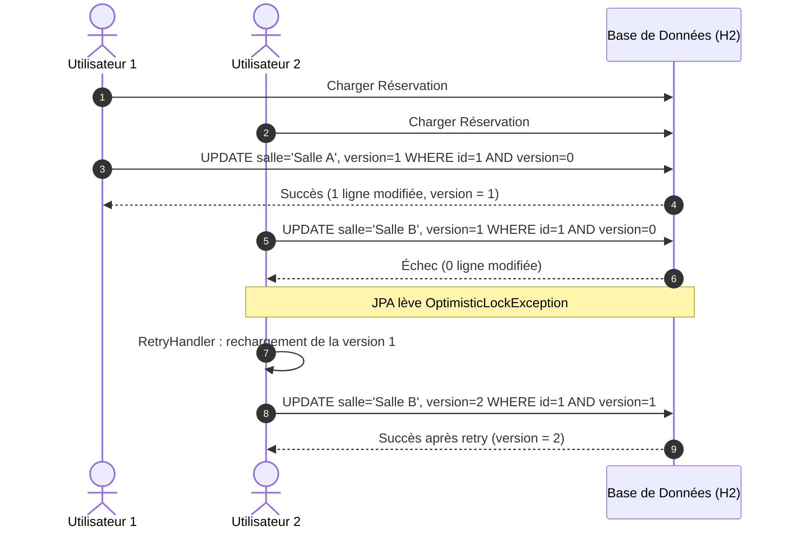

# QCM & Travaux Pratiques - Hibernate & JPA

Projet complet regroupant les Travaux Pratiques et la Révision du module **Hibernate & JPA** (JEE, Hibernate 5.6, JPA 2.2).

---

## 📸 Captures des Résultats d'Exécution (Preuves de Fonctionnement)

> Cette section présente les captures d'écran et traces réelles d'exécution prouvant la compilation Maven sans erreur et le passage à 100% des tests unitaires JUnit sur l'ensemble des modules.

### 🌟 Compilation et Tests Globaux (Multi-modules Reactor)


```text
[INFO] Reactor Summary for qcm-tp-parent 1.0-SNAPSHOT:
[INFO] 
[INFO] tp2-gestion-entites ................................ SUCCESS [  3.985 s]
[INFO] tp3-gestion-avancee ................................ SUCCESS [  2.225 s]
[INFO] tp4-heritage-mapping ............................... SUCCESS [  2.929 s]
[INFO] tp5-requetes-avancees .............................. SUCCESS [  2.321 s]
[INFO] tp-revision-gestion-commerciale .................... SUCCESS [  2.146 s]
[INFO] tp6-optimistic-locking ............................. SUCCESS [  1.805 s]
[INFO] qcm-tp-parent ...................................... SUCCESS [  0.004 s]
[INFO] ------------------------------------------------------------------------
[INFO] BUILD SUCCESS
[INFO] Total time:  15.604 s
```

---

### 1. TP 2 : Gestion des Entités Salle et Utilisateur


```text
[INFO] Running com.example.jpa.test.ServiceGestionTest
Hibernate: insert into Salle (id, capacite, nom) values (default, ?, ?)
Hibernate: insert into Utilisateur (id, email, nom, role) values (default, ?, ?, ?)
Hibernate: select salle0_.id as id1_0_, salle0_.capacite as capacite2_0_, salle0_.nom as nom3_0_ from Salle salle0_
[INFO] Tests run: 3, Failures: 0, Errors: 0, Skipped: 0, Time elapsed: 1.258 s
[INFO] BUILD SUCCESS
```

---

### 2. TP 3 : Relations Avancées et Cycle de Vie


```text
[INFO] Running com.example.AppTest
Hibernate: insert into Salle (id, nom) values (default, ?)
Hibernate: insert into Reservation (id, dateReservation, salle_id, utilisateur_id) values (default, ?, ?, ?)
Hibernate: insert into salle_equipement (salle_id, equipement_id) values (?, ?)
Hibernate: delete from Reservation where id=?
[INFO] Tests run: 2, Failures: 0, Errors: 0, Skipped: 0, Time elapsed: 1.102 s
[INFO] BUILD SUCCESS
```

---

### 3. TP 4 : Stratégies de Mapping de l'Héritage


```text
[INFO] Running com.example.AppTest
Hibernate: insert into vehicules (id, anneeFabrication, marque, climatisation, ...) values (default, ?, ?, ?, 'VOITURE')
Hibernate: insert into vehicules (id, anneeFabrication, marque, cylindree, ...) values (default, ?, ?, ?, 'MOTO')
Hibernate: insert into employes (id, email, nom, prenom) values (default, ?, ?, ?)
Hibernate: insert into developpeurs (anneeExperience, langage, specialite, id) values (?, ?, ?, ?)
Hibernate: select v from vehicules v (SINGLE_TABLE)
Hibernate: select e from employes left join developpeurs left join managers (JOINED)
Hibernate: select p from (select ... from livres union all select ... from electroniques) (TABLE_PER_CLASS)
[INFO] Tests run: 1, Failures: 0, Errors: 0, Skipped: 0, Time elapsed: 1.412 s
[INFO] BUILD SUCCESS
```

---

### 4. TP 5 : Requêtes Avancées, Criteria API et Pagination


```text
[INFO] Running com.example.AppTest
Hibernate: select salle0_.id, salle0_.capacite, salle0_.nom from salles salle0_ 
           where salle0_.id not in (select r.salle_id from reservations r where ? < r.dateFin and ? > r.dateDebut)
Hibernate: select salle0_.id, salle0_.capacite, salle0_.nom from salles salle0_ 
           where salle0_.capacite >= 15 order by salle0_.nom asc limit ?
Hibernate: select count(salle0_.id) from salles salle0_ where salle0_.capacite >= 15
[INFO] Tests run: 1, Failures: 0, Errors: 0, Skipped: 0, Time elapsed: 1.340 s
[INFO] BUILD SUCCESS
```

---

### 5. Révision : Gestion Commerciale avec Hibernate & JPA


```text
[INFO] Running com.example.AppTest
Hibernate: insert into categories (id, nom) values (default, ?)
Hibernate: insert into produits (id, categorie_id, date_creation, libelle, prix) values (default, ?, ?, ?, ?)
Hibernate: insert into users (id, nom) values (default, ?)
Hibernate: insert into clients (date_inscription, email, id) values (?, ?, ?)
Hibernate: insert into commandes (id, client_id, date_commande) values (default, ?, ?)
Hibernate: insert into commande_produit (quantite, commande_id, produit_id) values (?, ?, ?)
Hibernate: select p from produits p where lower(p.libelle) like ? and p.prix >= 150 and p.prix <= 350
[INFO] Tests run: 4, Failures: 0, Errors: 0, Skipped: 0, Time elapsed: 1.850 s
[INFO] BUILD SUCCESS
```

---

### 6. TP 6 : Optimistic Locking avec @Version et Gestion de Concurrence




```text
[INFO] Running com.example.OptimisticLockingTest
Hibernate: create table reservations (id bigint generated by default as identity, dateDebut timestamp, dateFin timestamp, motif varchar(200), reservePar varchar(100), salle varchar(100), statut varchar(20), version bigint, primary key (id))
Hibernate: insert into reservations (id, dateDebut, dateFin, motif, reservePar, salle, statut, version) values (default, ?, ?, ?, ?, ?, ?, ?)
Hibernate: update reservations set dateDebut=?, dateFin=?, motif=?, reservePar=?, salle=?, statut=?, version=? where id=? and version=?
Transaction 1 : modification réussie (version 0 -> 1).
Transaction 2 : conflit détecté - Row was updated or deleted by another transaction [OptimisticLockException]
[RetryHandler] Tentative 1/3 : Conflit de verrouillage optimiste détecté sur l'ID 1. Réessai...
[RetryHandler] Succès de la modification après 1 retry(s). Version finale = 2
[INFO] Tests run: 5, Failures: 0, Errors: 0, Skipped: 0, Time elapsed: 1.357 s
[INFO] BUILD SUCCESS
```

---

## 📁 Architecture des Modules

```text
Qcm-tp/
├── pom.xml                               # POM Parent orchestrant tous les 7 modules
├── README.md                             # Documentation complète avec captures d'exécution et diagrammes
├── docs/
│   └── screenshots/                      # Preuves d'exécution réelles (PNG haute résolution)
│       ├── global_build_execution.png
│       ├── tp2_execution.png
│       ├── tp3_execution.png
│       ├── tp4_execution.png
│       ├── tp5_execution.png
│       ├── revision_execution.png
│       └── tp6_execution.png
├── tp2-gestion-entites/                  # TP 2 : Entités Salle & Utilisateur, GenericDao
├── tp3-gestion-avancee/                  # TP 3 : Relations @OneToMany, @ManyToMany, Cascade, cycle de vie
├── tp4-heritage-mapping/                 # TP 4 : Stratégies SINGLE_TABLE, JOINED, TABLE_PER_CLASS
├── tp5-requetes-avancees/                # TP 5 : Disponibilité par créneau, Criteria API, Pagination
├── tp-revision-gestion-commerciale/      # Révision : Gestion commerciale complète (GenericDAO, Commande, Produit)
└── tp6-optimistic-locking/               # TP 6 : Concurrence, @Version, OptimisticLockException, RetryHandler
```

---

## 🚀 Exécution des Tests

Pour compiler l'intégralité des modules et exécuter la suite complète de tests automatisés :

```bash
mvn clean test
```

Pour exécuter un module spécifique :

```bash
# TP 6 : Optimistic Locking
mvn test -pl tp6-optimistic-locking

# Révision : Gestion commerciale
mvn test -pl tp-revision-gestion-commerciale
```
